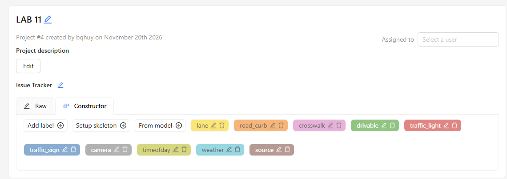
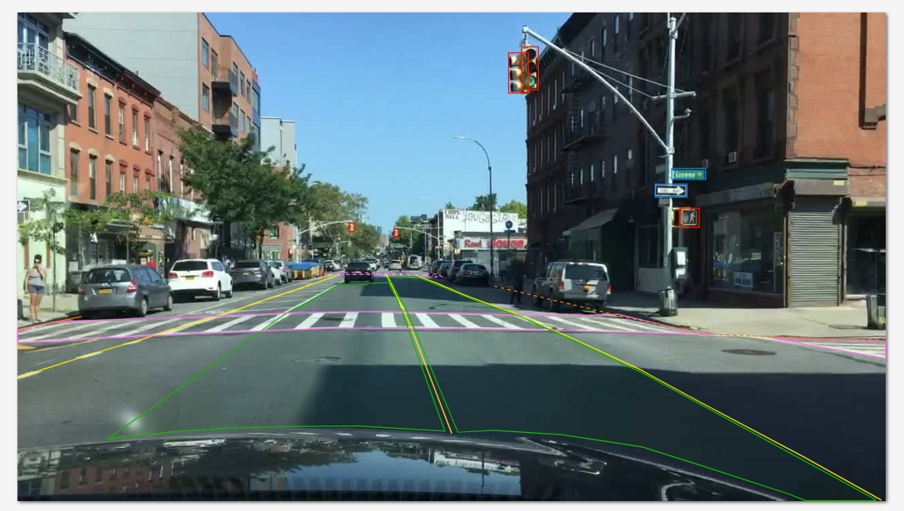
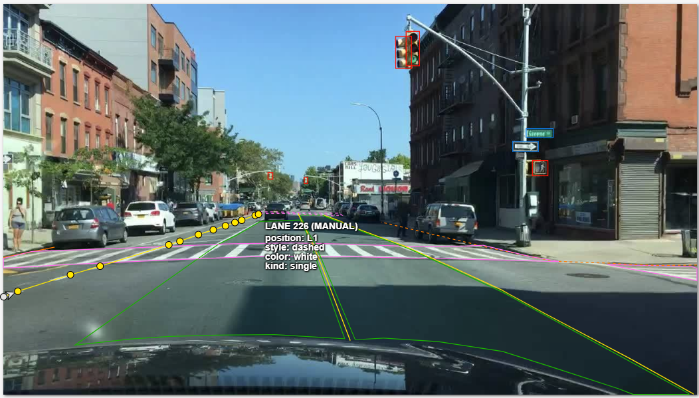
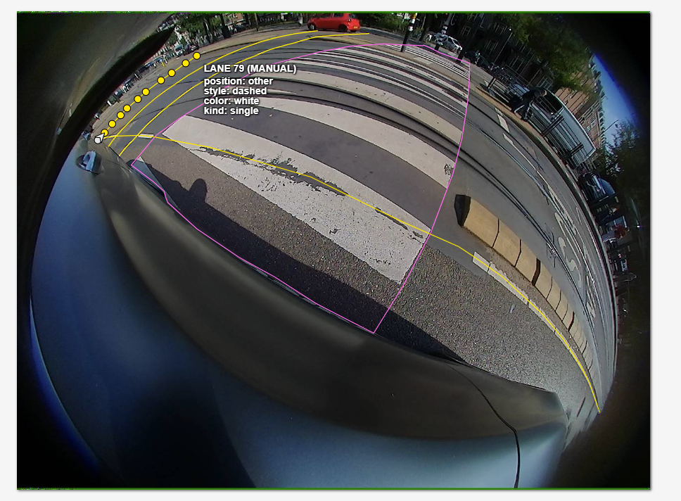
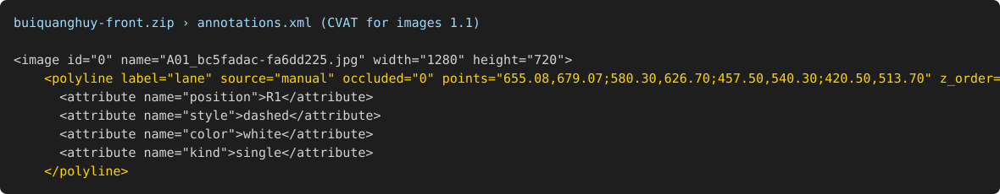

# Báo cáo cá nhân — Ngày 11
Họ tên: Bùi Quang Huy               Mã học viên: 2A202603201  
Phiên bản CVAT (Help → About): 2.82.1 (CVAT tự host trên máy, coach cho phép dùng thay CVAT lớp)  
Guideline: Road v1.0    Lần nộp (`revision` trong manifest): 1  
Thời điểm export (ngày giờ trên CVAT): 2026-11-20 16:18 UTC (front), 16:19 UTC (fisheye), tức 23:18–23:19 giờ Việt Nam    Số lần nộp lại sau Rework: 0  

## 1. Kiểm project
| Mục | Đúng như guideline Road v1.0? | Ghi chú |
| --- | --- | --- |
| 6 label, đúng kiểu | Có | lane, road_curb (polyline) · crosswalk, drivable (polygon) · traffic_light, traffic_sign (rectangle). Dán từ `configs/road_v1_labels.json` vào tab Raw; đối chiếu lại phần `<meta><labels>` trong file export: không thiếu, không thừa label |
| Thuộc tính và giá trị | Có | Mọi thuộc tính select/checkbox và danh sách giá trị trong file export khớp từng giá trị với `python -m road_lab.taxonomy` |
| 4 tag ảnh | Có | camera, timeofday, weather, source: mỗi tag là một label kiểu Tag có một thuộc tính select `value` |

Cách kết thúc polyline trên bản CVAT này: click lần lượt các điểm từ gần xe ra xa, xong bấm phím **N** (hoặc lại nút polyline) để kết thúc; sau đó mở **Details** sửa `position / style / color / kind` vì CVAT tự điền `L1 / solid / white / single`.  
Cách đặt tag ảnh trên bản CVAT này: dùng công cụ **Tag** ở thanh bên trái, chọn label (camera trước tiên), rồi mở Details trong bảng Objects để chọn `value`; CVAT tự điền giá trị đầu danh sách (`front`, `day`, `clear`, `real`) nên phải kiểm lại từng tag.  

Ghi chú: project trên CVAT local đặt tên `LAB 11` thay vì `d11-road-<tên>`; hai task export là `front` (A01–A12) và `fisheye` (B01–B08).

## 2. Số lượng đã gán
| Task | Ảnh | lane | road_curb | crosswalk | drivable | traffic_light | traffic_sign |
| --- | ---: | ---: | ---: | ---: | ---: | ---: | ---: |
| front | 12 | 32 | 16 | 9 | 22 | 52 | 51 |
| front-extra (đã làm 0 / 4) | 0 | — | — | — | — | — | — |
| fisheye | 8 | 10 | 17 | 8 | 7 | 10 | 6 |
| fisheye-extra (đã làm 0 / 4) | 0 | — | — | — | — | — | — |

Số liệu lấy từ `shapes_by_label` trong `buiquanghuy-manifest.json`. Mọi ảnh có đủ 4 tag (12/12 và 8/8), không ảnh nào chưa gán.

## 3. Bảng ca khó
| Ảnh | Nhãn | Phân vân giữa | Đã chọn | Lý do |
| --- | --- | --- | --- | --- |
| A06 | lane vàng đôi (`color=yellow`, `kind=double`) | `style` solid hay dashed (vạch đôi một nét liền, một nét đứt, QCVN 1.4) | dashed | Road v1.0 không có style riêng cho vạch 1.4. Nét nằm phía làn xe mình là nét đứt, và nét đó quyết định xe mình có được vượt hay không |
| B03 (áp dụng cho mọi ảnh `fisheye_rear`) | lane `position` | L/R tính theo hướng xe (người lái) hay theo trái/phải của ảnh | Theo xe: L1 là vạch bên trái xe, nằm ở **bên phải** ảnh camera sau | Guideline định nghĩa L1/R1 theo làn xe đang đi. Một vạch thật phải mang cùng position ở camera trước và camera sau, nếu không model ghép 4 camera sẽ học mâu thuẫn. Chưa có lời đáp của coach |
| Ảnh `fisheye_rear` có biển/đèn quay mặt thẳng vào camera sau (B04) | traffic_sign / traffic_light `facing` | front hay back (biển dành cho chiều ngược lại) | front | Rubric gọi `facing=front` là "quay về xe": mặt biển quay về đuôi xe và đọc được nội dung. `facing` mô tả hướng mặt biển so với xe, không mô tả biển dành cho chiều nào |
| A05 | lane L1/R1 | Vẽ L1/R1 theo mép xe đỗ, hay không vẽ | Không vẽ lane, chỉ gán `road_curb` và `drivable` | Đường không có vạch sơn nào. Lint báo QC1-02, nhưng guideline cấm vẽ vạch không có; chờ coach xác nhận miễn |
| A07 | lane L1 | Coi chân dải phân cách bê tông là L1, hay chỉ là road_curb | road_curb, không có L1 | Bên trái làn là dải bê tông, không thấy vạch sơn rõ; vạch mép có sơn mới là lane. Chờ coach xác nhận miễn QC1-02 |
| A05, A06, A07 | tag `weather` | clear hay overcast/rain | A05, A06: `overcast`; A07: `rain` | A05, A06 trời âm u nhưng đường khô. A07 đường ướt và kính có giọt mưa ("mặt đường ướt rõ do mưa") |

## 4. Phiếu QC 1 nhận được
Bạn kiểm lô của tôi: chưa có (không được ghép cặp trong buổi)  Quyết định nhận được: chưa có  

Chưa nhận phiếu QC 1 nào nên chưa có lỗi để đối chiếu. Thay vào đó, tôi tự kiểm bằng `road_check lint` và đọc lại toàn bộ thuộc tính trong XML trước khi nộp. Các lỗi tự tìm và đã sửa trước lần nộp này (revision 1):

| Mã lỗi | Số lỗi | Đồng ý? | Đã sửa? |
| --- | ---: | --- | --- |
| QC1-01 thiếu cả 4 tag (A04, B03) | 2 ảnh | Có | Có |
| QC1-01 sai tag weather (A05, A06, A07) | 3 | Có | Có |
| QC1-02 thiếu L1/R1 thấy được (A03 L1 vàng đôi, A12 L1, A09 R1, A06 R1) | 4 | Có | Có |
| QC1-02 thiếu L1/R1 ở ảnh không có vạch (A05, A07) | 3 cảnh báo | Không phải lỗi: không có vạch để vẽ | Chờ coach xác nhận miễn |
| QC1-03 lane camera hai bên để L1/L2 (B05) | 2 | Có | Có, đổi thành `other` |
| QC1-04 vẽ ngược chiều (B03 hai lane + hai road_curb, A12 R2) | 5 | Có | Có |
| QC1-05 hình bị nhân đôi (A02, mọi hình) | 9 | Có | Có, xoá bản trùng |
| QC1-07 road_curb vẽ từ xa về gần (A05) | 1 | Có | Có |
| QC1-07 / QC1-08 / QC1-10 box thấp hơn 8 px (A04, A07, A10) | 4 | Có | Có, xoá |
| QC1-11 `edge_zone` (B02 bốn đèn, B03 biển #10, B04 biển #2; B03 biển #4 bật nhầm) | 7 | Có | Có |
| QC1-11 road_curb fisheye chỉ 3 điểm (B02) | 1 | Có | Có |

Nếu sau buffer nhận được phiếu, tôi sẽ cập nhật mục này và nộp lại với `--revision 2`.

## 5. Kiểm file export
| File | Mở lại được? | Số shape ảnh 1 (job / file) | Số shape ảnh 2 (job / file) | Tag camera có trong XML? |
| --- | --- | --- | --- | --- |
| `buiquanghuy-front.zip` | Có. `road_check lint` đọc đủ 12 ảnh; zip chỉ có `annotations.xml`, `contains_images=false` | A01: __ / 9 | A02: __ / 8 | Có, 12/12 ảnh `camera=front` |
| `buiquanghuy-fisheye.zip` | Có. `road_check lint` đọc đủ 8 ảnh; zip chỉ có `annotations.xml`, `contains_images=false` | B01: __ / 7 | B02: __ / 13 | Có, 8/8 ảnh, đúng hậu tố: FV→`fisheye_front`, RV→`fisheye_rear`, MVL→`fisheye_left`, MVR→`fisheye_right` |

Lint lần cuối: 20 ảnh, 3 cảnh báo, đều là QC1-02 ở A05 (L1, R1) và A07 (L1), hai ảnh không có vạch để vẽ (xem mục 3). Không còn cảnh báo mức chính hay nhẹ.

```
PYTHONPATH=src python -m road_lab.road_check lint buiquanghuy-front.zip buiquanghuy-fisheye.zip \
    --manifest buiquanghuy-manifest.json --name buiquanghuy --revision 1
```

## 6. Ảnh chụp màn hình
1. Tab Labels của project.

   

2. Một ảnh camera trước đã gán đủ (làn, vùng lái, đèn/biển): A12, gồm lane, drivable direct/alternative, crosswalk, road_curb, đèn và biển.

   

   Cùng ảnh, chọn polyline L1 để thấy thuộc tính `position: L1 · style: dashed · color: white · kind: single`:

   

3. Một ảnh fisheye đã gán, phóng to đoạn polyline cong: B06 (`fisheye_left`), lane `position: other` đi theo cung, điểm đặt dày ở vòng ngoài.

   

4. Một đoạn XML có `<polyline label="lane">`, trích từ `annotations.xml` trong `buiquanghuy-front.zip` (ảnh A01, lane R1):

   

## 7. Tự đánh giá
Lỗi bạn mắc nhiều nhất hôm nay (theo mã QC1-xx), và cách tránh ở Ngày 20:  
Nhiều nhất là **QC1-02, bỏ sót L1/R1** ở 4 ảnh (A03, A06, A09, A12), rồi đến **QC1-01, thiếu hoặc sai tag** (A04, B03 thiếu cả 4 tag; 3 ảnh để `weather=clear` mặc định). Nguyên nhân chung là tôi tập trung vào trọng tâm của ảnh (đèn, biển, vùng lái) và đặt nhiều nhãn ngoài trọng tâm, nên quên kiểm phần bắt buộc ở mọi ảnh. Ở Ngày 20, tôi sẽ:
- làm đúng thứ tự guideline cho từng ảnh: 4 tag, rồi L1/R1, rồi mới đến nhãn trọng tâm;
- trước khi sang ảnh sau, nhìn hai bên làn xe mình một lần để chắc đã có L1 và R1;
- export và chạy `lint` sau 2–3 ảnh đầu, không đợi cuối buổi.

Nhãn của bạn đi vào model ở đâu? Chọn một lỗi đã sửa và nói nó làm model học sai thế nào:  
Polyline `lane` có `position` là đích cho model phát hiện làn kiểu row-anchor: mỗi hàng ảnh có một giá trị x cho L1 và R1, model dùng hai giá trị này để tìm làn xe mình, phục vụ cảnh báo lệch làn (LDW) và giữ làn (LKA). Lỗi đã sửa ở **A03**: vạch vàng đôi bên trái (L1) không được vẽ, chỉ có road_curb của dải phân cách. Nếu nộp như vậy, model học rằng vạch vàng đôi là nền, còn mép trái làn xe mình là bó vỉa ở xa hơn. Khi chạy thật, LKA sẽ cho rằng làn rộng hơn thực tế và để xe lấn qua vạch vàng sang làn ngược chiều mà không cảnh báo. Đây là lỗi an toàn nặng nhất trong các lỗi của tôi. Lỗi ở **B05** (lane camera hai bên để `L1/L2` thay vì `other`) làm model gán nhầm vạch nhìn từ camera bên thành ranh giới làn xe mình, khiến việc ghép 4 camera bị mâu thuẫn.

## 8. (Tùy chọn, buffer) Từ polyline đến đích row-anchor
Ảnh A01, vạch L1 (trắng đứt), tính bằng nội suy tuyến tính giữa hai điểm kẹp mỗi hàng, kiểm lại bằng `python -m road_lab.rowanchor buiquanghuy-front.zip --image A01 --position L1`:

| y | 720 | 680 | 640 | 600 | 560 |
| --- | ---: | ---: | ---: | ---: | ---: |
| x của chúng tôi | 110.7 | 155.9 | 202.1 | 249.3 | 297.1 |
| x của bạn kia | — | — | — | — | — |

Trả lời 3 câu:

1. Polyline L1 của A01 đi từ y = 720 lên y ≈ 508. Dừng sớm 40 px thì điểm cuối ở y ≈ 548, vẫn qua cả 5 hàng, nên **không hàng nào** đổi thành "không có làn". Ngược lại, bắt đầu muộn mới gây hại: R1 của A01 bắt đầu ở y ≈ 679, nên hàng 720 và 680 đã là "không có làn". Vì vậy guideline yêu cầu điểm đầu sát xe phải chính xác nhất.
2. Không có bạn được ghép nên không so được. Lệch ở **hàng 720** (gần xe nhất) ảnh hưởng LKA nhiều hơn, vì đó là vị trí ngang của vạch ngay trước bánh xe, dùng trực tiếp để tính độ lệch của xe so với tâm làn. Lệch ở hàng 560 (xa) chỉ làm sai hướng cong dự đoán.
3. Các số x không đổi, vì nội suy chỉ tìm đoạn kẹp hàng y, không phụ thuộc thứ tự điểm. Nhưng các script dựa vào thứ tự sẽ gặp khó: `road_check` coi điểm đầu là điểm gần xe để kiểm chiều vẽ và điểm dừng (báo QC1-04), `rowanchor` sẽ in cảnh báo vẽ từ xa về gần, và mọi bước lấy "điểm đầu = gần xe" để biết làn bắt đầu từ đâu đều sai.
